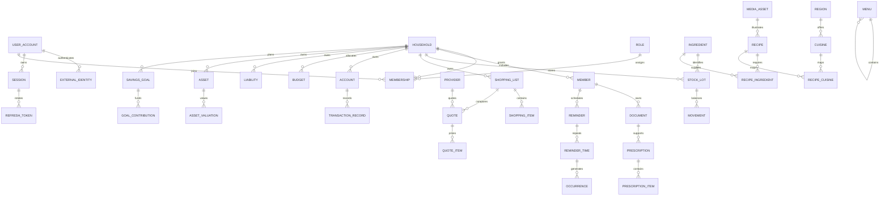

# Aarohi data model

The diagram is an overview. SQL composite foreign keys, especially household and member ownership, are the authoritative relationships; see `SCHEMA_REFERENCE.md`.

| Area | Key design |
|---|---|
| Configuration | Typed core tables; JSON only for flexible theme/provider/settings payloads, not primary relationships |
| Pictures | Reusable media metadata with real packaged image files; private health documents use a separate model |
| Authentication | Google subject/issuer identities, keyed OTP checks, revocable sessions and hashed refresh lineage |
| Family | Login account differs from family member; one user can belong to multiple households |
| Health | Document ownership and prescription items constrained to the correct member; draft extraction is separate |
| Food | Recipe-to-cuisine mapping supports different styles without duplicate recipe/photo records |
| Pantry | Lot-based expiry and movement-based stock; alert rules per ingredient/unit |
| Reminders | Schedules differ from occurrences, completion and delivery attempts |
| Shopping | One list model with strict grocery/medicine branches; quotes/orders preserve provenance |
| Finance | Plans differ from posted transactions; valuation history and savings contributions remain auditable |

Required API transactions, not implemented in this DB-only phase: account-link verification; OTP consumption and attempt locking; refresh rotation/replay revocation; last-admin protection; membership/consent enforcement; balanced account transfers; scheduler occurrence/outbox creation and retry leases; pharmacy review/checkout; external-provider synchronization. These require authenticated requests or workers and cannot be supplied by seed data.

Latest design adds nine tenant-scoped tables and six configuration/catalogue tables (91 application tables total). See LATEST-DESIGN.md and migration 008 for the scenario aggregate and language/media/comparison additions.
